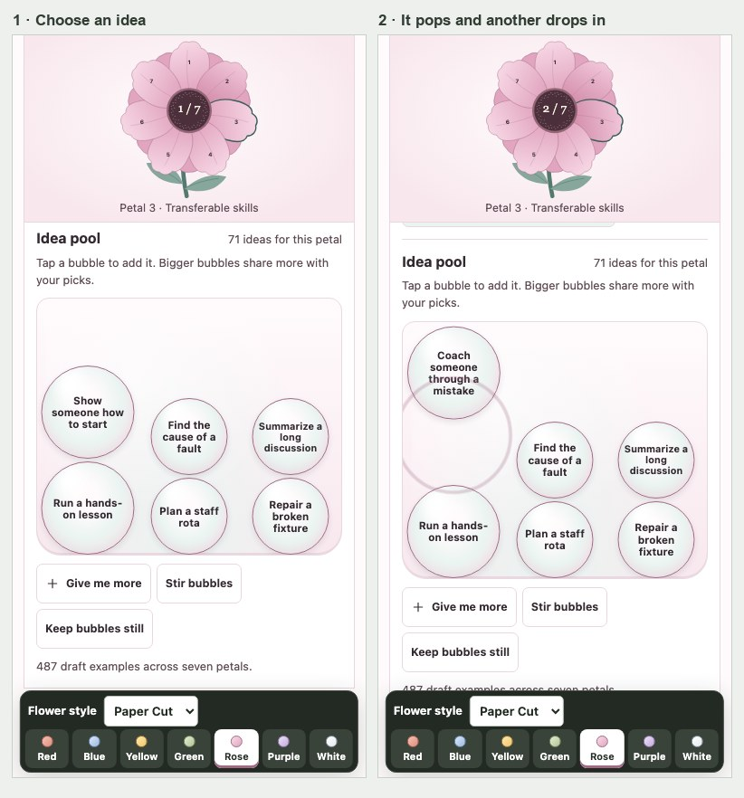
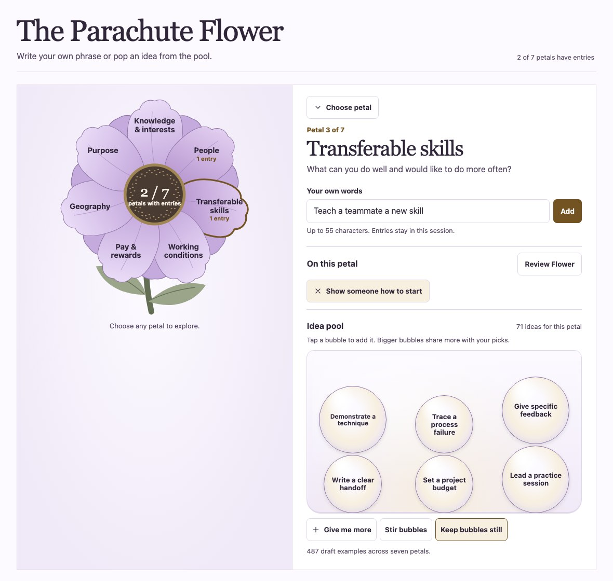
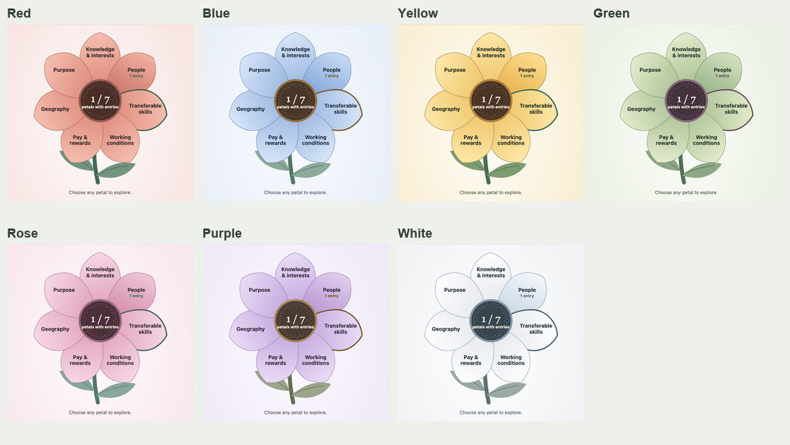

# Parachute Flower planning and handoff

**Status:** V2 is the approved planning baseline. The public GitHub Pages site serves the approved preview. Source and dated release history live here. The full interaction contract and earlier comparison boards are in the Chute project in AI Brain.

## Decisions we are carrying forward

- One lightweight, responsive Flower and seven petals in the order used by the expanded blank worksheet. V1 retains the earlier prototype’s order and design. The V1 archive uses general example prompts.
- Sunroom places the sunflower beside the editor on desktop. The flower stays visible on phones, including during Review. Garden, Herbarium, and Paper Cut can be paired with seven soft palettes. Garden and Yellow are the current defaults.
- People can type a phrase or pop a suggestion. V2 keeps six bubbles in play, draws another after a pop, and offers fresh batches and a still mode. The 487 generic suggestions are an editorial draft.
- Review can open on a partial Flower, and returning to the editor restores its draft. Print uses added entries and gives three US Letter pages. The existing blank packet is a separate reference. The 105-option print sheet is a short reference for the larger interactive catalog.
- Review a realistic image of each affected stage before building it. Use matching phone and desktop states, plus page renders for print. After implementation, replay the same sequence with real controls.

## Remaining planning decisions

| Order | Decision or proof | Owner |
| --- | --- | --- |
| 1 | Open V2 from an actual phone on mobile data. Try adding a phrase, popping an idea, switching petals, opening Review, and returning to a draft. Note any controls that are hard to reach or read. | Joe tries the preview. Builder records and addresses what he finds. |
| 2 | Confirm whether Garden and Yellow should stay as the default. Try several petals and decide whether the bubble speed, replacement variety, and still control feel right. | Joe decides after the walkthrough. |
| 3 | Review the 487 prompts for useful variety, repetition, unclear wording, and short labels on phones. Mark the catalog revision that is ready to use. | Builder prepares the review. Joe approves the set. |
| 4 | Decide what must survive a refresh and whether the same Flower needs to follow someone across devices. If sharing is needed, design the sign-in, save, reopen, conflict, and recovery screens before adding storage. | Joe decides what he needs. Builder proposes the smallest matching design and verifies it. |
| 5 | Update the stage images for the next approved change. Start with a two-petal walkthrough. Check draft retention, touch and keyboard, reduced motion, and print before freezing the next release. | Builder prepares the next slice. Joe reviews the images. |

The app currently keeps its entries in memory. Account storage, shared saving, and public deployment are separate decisions. The phone review can proceed with V2 while those are open.
